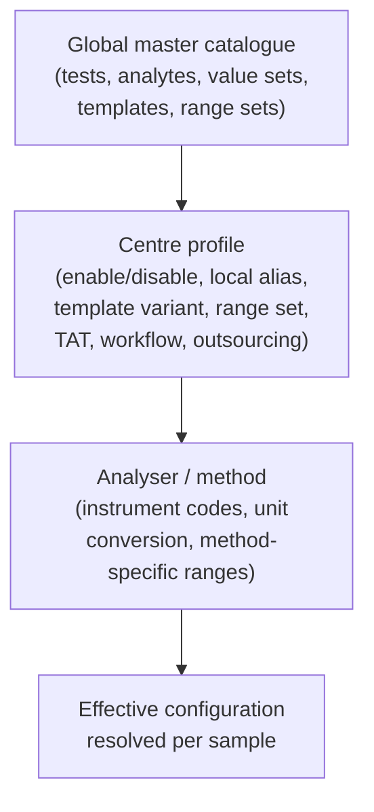
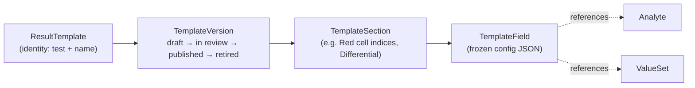
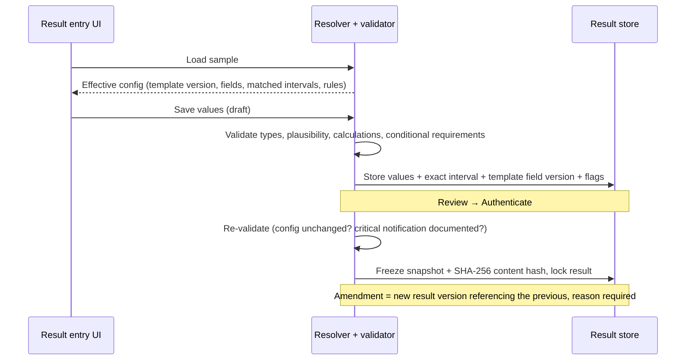

# Laboratory Resulting — Configurable Templates & Test Configuration (Design Proposal)

Status: **Proposal for review** · Scope: PRD §8 (FR-CAT-001, FR-LAB-001..003) · Owner: Laboratory platform

---

## 1. Summary

The platform already has the basics of §8: a test catalogue, `TestParameter` with ten result types,
age/sex `ReferenceRange` rows, versioned `ResultTemplate`s, and a JSON snapshot frozen at authentication.
What it lacks is the **structure that makes configuration safe to change and safe to localise**:

1. Published templates point at *live* parameters, so editing a unit, precision or choice list silently
   changes every "published" template that uses it.
2. Reference-range "versions" are a free-typed integer on individual rows. There is no approved, dated,
   immutable range set, and the snapshot records *all* active rows rather than the exact interval used.
3. Everything is global. Centres cannot enable/disable tests, choose a template variant, adopt a
   different approved range set (e.g. a different analyser/method), or set local TAT/workflow.
4. Field types exist as labels, but `TABLE` is stored as a single number, differentials have no
   sum-check, calculations cannot use age/sex (eGFR) or functions, and qualitative values cannot be
   critical (e.g. *Malaria parasite: Seen*).
5. Critical results only fire on numeric limits and only demand a comment — there is no documented
   notification/read-back, no delta check, no plausibility (absurd-value) limits.
6. No approval step: one user can author and publish a template or range on their own.

The proposal below keeps the existing tables where possible and evolves them in phases. Nothing
clinical is hardcoded in the frontend; the server resolves the *effective configuration* for a
given sample (test × centre × patient × date) and the UI only renders it.

---

## 2. Design principles

| Principle | What it means in practice |
|---|---|
| **Separate identity from version** | A test, analyte, template or range set has a stable identity; its clinical content lives in immutable versions. |
| **Immutable once approved** | Published template versions and approved range sets are never edited — only superseded by a new version. |
| **Four-eyes governance** | Author ≠ approver for templates, range sets and critical rules. Every change carries a reason. |
| **Layered configuration** | Global master (HFDN laboratory leadership) → Centre override → (optional) Analyser/method. The most specific approved layer wins. |
| **Freeze at the point of use** | Each result value records the exact template-field version and exact reference interval used, at entry, re-validated at authentication. |
| **Server-side truth** | Flagging, calculations, validation and critical detection run on the server. The browser previews but never decides. |
| **Data-driven field types** | Field types are a registry with a validated JSON config, so new types do not need schema changes. |

---

## 3. Configuration layers (centre flexibility)

**`CentreTestConfig`** (new, one row per centre × test, all fields optional = inherit global):

- `is_enabled`, `local_display_name`, `is_orderable_at_reception`
- `template_binding` → a published template version or "follow latest published"
- `range_set_policy` → use global approved set, or a centre-approved set (see §6)
- `tat_target_minutes`, `workflow_code` (+ pinned workflow version, optional)
- `outsourcing`: `processed_locally | outsourced | either`, `partner_lab`, send-out TAT
- `default_analyser`, `requires_pathologist_authentication`
- `comments_required`, `report_section_overrides`

**Resolver** — a single service, `resolve_effective_config(test, centre, patient, at=now)`, returns
the template version, field definitions, matched intervals, critical rules, workflow and TAT.
Result entry, analyser import, report rendering and the portal all call it; no other code reads the
raw tables directly. This replaces the scattered `resolve_entry_template` / `matching_range` calls.

Governance (agreed, §11): centres may **author** their own template, range-set and rule variants,
approved by their own laboratory director; whether author ≠ approver is enforced is a per-centre
setting.

---

## 4. Test catalogue configuration

Extend `Test` (identity + operational settings, audited edits) rather than versioning it — operational
fields like container or volume change rarely and do not alter released reports.

| Requirement | Current | Proposed |
|---|---|---|
| Code, name, department, service group | Yes | Add `Department` model (replace free-text `department` + digit code); add `loinc_code`, `synonyms` for search. |
| Specimen & collection | `specimen_type`, `collection_requirements` | Allow **multiple acceptable specimens** (`TestSpecimenRequirement`: specimen, container, min volume + unit, preferred flag); add `patient_preparation` (fasting etc.), `stability` (room/fridge/frozen hours), `rejection_criteria` (haemolysed, clotted…). |
| Volume, container, handling | Free text | Structured volume (`decimal` + unit), container M2M kept, handling text kept. |
| Workflow & version | `default_workflow_code` string | `WorkflowAssignment` stays; add optional **pinned version** and record the bound version on the order (already done by `OrderWorkflowInstance`). |
| Turnaround target | `tat_target_minutes` + `TatRule` | Keep; centre override via `CentreTestConfig`; STAT-specific targets per `StatType`. |
| Tariff eligibility | Implicit via `TestPrice` | `is_billable`, `requires_price_to_order` (block ordering on tariffs without a price), eligible client types. |
| Outsourcing | `is_outsourceable`, `default_outsource` | `ReferenceLab` model (partner, contact, send-out TAT, result format: structured or attached PDF). |
| Result template & ranges | `default_template` | Via template binding (§5) and range sets (§6). |
| Units, precision, type | On `TestParameter` | Moved to analyte + frozen on template field version (§5). |
| Critical rules, required comments | Two booleans | Rule set (§7). |
| Instrument mappings | `AnalyzerTestMapping` | Extended (§9). |
| **Panels / profiles** | — | `is_panel` + `PanelMember` (e.g. *Lipid profile*, *LFT*): one order, one sample, one report, many tests. |

---

## 5. Analytes, value sets and the template builder

### 5.1 Reusable building blocks

- **`Analyte`** (evolves `TestParameter`): the measurable thing — *Haemoglobin*, *WBC*, *HIV 1/2 Ab*.
  Fields: `code`, `name`, `loinc_code`, `default_unit`, `result_type`, `default_precision`,
  `plausible_min/max`. Shared across tests: *Haemoglobin* in the CBC and in a stand-alone Hb test
  is one analyte with one set of ranges, so labs maintain ranges once.
- **`Unit`**: controlled list (UCUM code + display, e.g. `g/dL`, `10^9/L`) with optional conversion
  factors (g/dL ↔ g/L, mg/dL ↔ mmol/L per analyte). Stops "g/dl", "g/dL", "gm%" drift.
- **`ValueSet` / `ValueSetOption`**: reusable controlled vocabularies — *Positive/Negative/Equivocal*,
  *Seen/Not seen*, *Reactive/Non-reactive*, *S/I/R*, blood groups, urine colours. Each option carries
  `code`, `display`, `interpretation` (normal / abnormal / critical), `sort_order`, and
  `report_text`. This is how qualitative results get flags and critical values.
- **`CannedComment`**: approved phrase library (by department/test) inserted into comments and
  interpretations, so free text stays consistent.

### 5.2 Template structure

The key change: **`TemplateField` stores a frozen copy of its configuration** (unit, precision,
value set version, formula, display options) at publish time instead of reading the live
`TestParameter`. Editing an analyte after publication only affects *new* template versions.

### 5.3 Field type registry

Each type has a server-side validator and a JSON config schema. Proposed set:

| Field type | Config | Example |
|---|---|---|
| `NUMERIC` | unit, precision, plausible min/max, allow `<` / `>` qualifiers, show reference interval | Hb 13.2 g/dL; CRP `<0.5` mg/L |
| `TEXT` / `RICH_TEXT` | max length, canned-comment library | Film comment, histology narrative |
| `SINGLE_SELECT` | value set | Blood group |
| `MULTI_SELECT` | value set, min/max selections | Urine microscopy elements |
| `QUALITATIVE` | value set with normal/abnormal/critical per option | HIV: Reactive (abnormal) |
| `TITER` / `RATIO` | allowed dilutions | Widal O 1:160 |
| `GRID` (table) | column definitions (each a field type), fixed or user-added rows | Antibiotic sensitivity: drug × zone × S/I/R |
| `DIFFERENTIAL` | member analytes, total (100 % or N cells), counter-keyboard entry, auto absolute counts | Neutrophils/Lymphocytes/Monocytes… must sum to 100 |
| `CALCULATED` | formula, dependencies, may use `age`, `sex`, `weight`; functions `round`, `log`, `pow`, `min`, `max`, `if` | Absolute neutrophils, LDL (Friedewald), eGFR, A/G ratio |
| `COMMENT` | per-field or per-section, canned comments | Specimen haemolysed |
| `SPECIMEN_NOTE` | value set of specimen-quality notes | Lipaemic, clotted |
| `SECTION_TEXT` | approved static text (read-only) | Methodology / disclaimer |
| `ATTACHMENT` | file types | Outsourced lab PDF, gel image |

**Conditional rules** per field: *show when*, *require when* (e.g. show the sensitivity grid only
when *Organism isolated = Yes*; require a comment when *Film = Abnormal*).

### 5.4 Builder UX (platform admin & lab leads)

1. Start from a **library** template (HFDN master CBC, LFT, Urinalysis, MCS…) or clone an existing one.
2. Drag analytes/fields into sections; set per-field options (required, print, show previous result,
   hide when empty).
3. **Preview & simulate**: pick a test patient profile (e.g. female, 34 y, pregnant T2), type values,
   see flags, calculations, critical alerts and the printed report — before submitting for approval.
4. Submit for review → approver sees a **diff against the previous version** → approve & publish
   (with effective date) or return with comments.
5. In-progress drafts keep the version they started with; only new entries use the new version.

---

## 6. Reference intervals

Replace free-standing `ReferenceRange` rows with **approved, versioned range sets**.

- **`ReferenceRangeSet`**: `analyte`, `scope` (global / centre / analyser-method), `version`,
  `status` (draft → approved → retired), `effective_from/to`, `source` (manufacturer insert,
  local verification study, literature), `approved_by/at`, `change_reason`. Immutable once approved.
- **`ReferenceInterval`** (rows inside a set), population criteria:
  - `sex`: any / male / female (extendable)
  - `age_low` / `age_high` **with unit** (days / weeks / months / years) — neonatal ranges need days;
    the current `DecimalField(5,1)` in years cannot express *0–7 days*.
  - lower bound inclusive, upper bound exclusive (no overlapping gaps at birthdays)
  - optional `pregnancy_status` / trimester, `specimen_type`, `method`
  - `low`, `high`, `critical_low`, `critical_high`, `display_text`, `interpretive_note`
  - for qualitative analytes: `expected_option` from the value set
- **Validation on approval**: no overlapping intervals for the same population, no age gaps (or an
  explicit "no range for this population" row), `low < high`, critical outside normal.
- **Matching** is deterministic: most specific match wins (method > specimen > pregnancy > sex >
  age); if none matches the value is reported **without a flag and with "No reference interval for
  this population"** rather than silently falling back to another population.
- Units are bound to the set; values from an analyser in another unit are converted before flagging.

---

## 7. Critical results and result rules

A **`ResultRule`** set per analyte (versioned with the range set or template):

| Rule kind | Example | Action options |
|---|---|---|
| Critical limits (numeric) | K⁺ < 2.5 or > 6.5 mmol/L | flag, require comment, **require documented notification**, block release until documented |
| Critical value (qualitative) | Malaria parasite: *Seen*; Blood culture: *Growth* | same as above |
| Plausibility / absurd | Hb > 25 g/dL | block save; "re-check / re-run" |
| Delta check | Creatinine changed > 50 % vs previous within 7 days | warn, require comment |
| Required comment | Any abnormal value on this field | require comment |
| Reflex / recommendation | TSH high → suggest FT4 | suggestion only (no auto-order without config) |

**`CriticalNotification`** (new): result, value, who notified, whom (clinician/patient/ward),
channel, timestamp, **read-back confirmed**, escalation if not acknowledged within the configured
minutes (re-using the TAT escalation machinery). Report prints "Critical value communicated to … at …".

---

## 8. Result entry, storage and the authentication snapshot

### 8.1 Storage changes on `ResultValue`

- `value_text` (existing), plus `value_numeric` (Decimal), `value_qualifier` (`<`, `>`, `=`),
  `value_json` (grids, multi-select, differentials), `value_option` (FK to value-set option).
- `template_field` (exact field version), `unit_at_entry`
- `reference_interval` (FK to exact row) + `range_set_version`, `reference_display`
- `flag` (L, H, LL, HH, A, critical), `is_critical`, `delta_flag`
- `source`: manual / analyser / calculated / imported; `analyzer_message` FK
- `entered_by/at` per value (for partial and analyser-assisted entry)

### 8.2 Lifecycle

The existing `configuration_snapshot` is kept but slimmed to the **exact** template version id,
field configs, interval ids/versions and values used, plus a content hash so a reprinted report can
be proven identical to the authenticated one. Amendments create `LabResult.version + 1` with the
previous snapshot retained and the reason printed on the amended report.

### 8.3 Entry UX

- Keyboard-first grid; differential counter mode; live (server-confirmed) flags; previous result and
  trend inline; critical banner with "document notification" dialog.
- Partial save; analyser values shown as "instrument" with accept/override (override requires reason).

---

## 9. Instrument mappings

Extend `AnalyzerTestMapping` → **`AnalyserChannelMapping`** (versioned per analyser):

- `instrument_code` → `analyte` (+ template field where an analyte appears in several templates)
- `instrument_unit` + conversion to the analyte's reporting unit
- `value_translation` map (e.g. `POS` → *Positive* option, `***` → *Error*)
- `instrument_flags` handling (e.g. `H`, `*`, `QC fail`) → hold for review
- `method` (drives method-specific range sets), `is_enabled`
- **Autoverification eligibility** (later phase): accept automatically when within range, no
  critical, no delta failure, QC passed — otherwise route to manual review.
- An **unmapped-codes queue** shows instrument codes received but not mapped.

---

## 10. Reports (formatted clinical output)

- Template versions own **report layout**: section order, column set (result, unit, flag, interval,
  previous result), hide-empty, page-break hints, approved header/footer text, methodology notes.
- Centre branding stays in `CentreReportFormat`.
- Released PDFs are rendered **only from the frozen snapshot**, never from live configuration.
- Report shows template version and range-set version in the footer (small print) for traceability.

---

## 11. Decisions (agreed 23 Nov 2026)

1. **Centre autonomy — centres author their own variants.** Templates, range sets and result rules
   carry an `owner_centre` (null = global master). A centre may clone a global item into its own
   scope and edit it; approval is by a user holding the new `approve_lab_configuration` permission
   *at that centre* (its laboratory director). The resolver prefers the centre's approved item, then
   the global one. Global master items remain editable only by HFDN laboratory leadership.
2. **Analytes are shared** across tests, with ranges maintained once per analyte (per scope).
3. **Approval is configurable per centre.** New `CentreLabGovernance` settings:
   `require_independent_approval` (author ≠ approver) for templates, range sets and rules
   separately. Global master items always require independent approval. Self-approval, where
   allowed, is still recorded as a distinct approve event with a reason.
4. **Critical-release blocking is configurable per test** (`Test.critical_release_policy`:
   `block_until_notified` / `warn_only`), overridable in `CentreTestConfig`.
5. **Units are configurable per analyte and centre.** Each analyte has a canonical storage unit;
   `CentreTestConfig` / analyte display settings choose the reporting unit, with conversion factors
   held on `Unit`. Values, ranges and snapshots store the canonical value plus the displayed unit.
6. **Phase order** — pending review of this document.

---

## 12. Phased delivery (migration-safe)

| Phase | Deliverable | Migration of existing data |
|---|---|---|
| **1. Integrity** | Frozen `TemplateField` config; `ReferenceRangeSet` + approval; exact interval stored on `ResultValue`; slim snapshot + hash; approval step (independent approval enforced for global items). `owner_centre` added to templates and range sets now (null = global) so Phase 4 needs no reshaping. | Each test's current ranges become *v1 approved (migrated)* sets; current templates become v1 published with frozen field config. Existing authenticated results untouched. |
| **2. Building blocks** | `Analyte`, `Unit`, `ValueSet`, `CannedComment`; age units; qualitative flags. | `TestParameter` → `Analyte` (deduplicated by code/name with a review screen); `choices` JSON → value sets. |
| **3. Field types** | Grid, differential, titer, calculated v2 (age/sex, functions), conditional rules, attachment. | Existing `TABLE` rows mapped to differential/grid. |
| **4. Centre layer** | `CentreTestConfig`, `CentreLabGovernance`, centre-owned template/range-set/rule variants with centre approval, resolver service, per-centre reporting units, panels, structured specimen requirements, reference labs. | Every centre gets "inherit global" defaults — no behaviour change until configured. |
| **5. Critical management** | Rule sets, plausibility, delta checks, `CriticalNotification` + escalation. | Existing critical limits become rules. |
| **6. Instruments** | Channel mappings v2, unit conversion, value translation, unmapped queue, autoverification (optional). | Existing mappings carried over. |
| **7. Builder & reports** | Drag-and-drop builder, simulate/preview, version diff, report layout editor, master template library (CBC, LFT, RFT, Lipids, Urinalysis, MCS, Widal, Malaria, HIV, HBsAg, FBS…). | — |

Each phase is shippable on its own and keeps the current entry screen working until its replacement
is switched on per centre.
