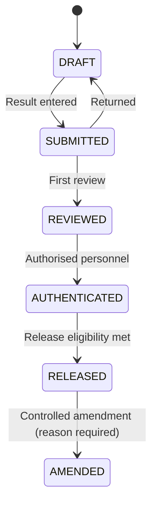
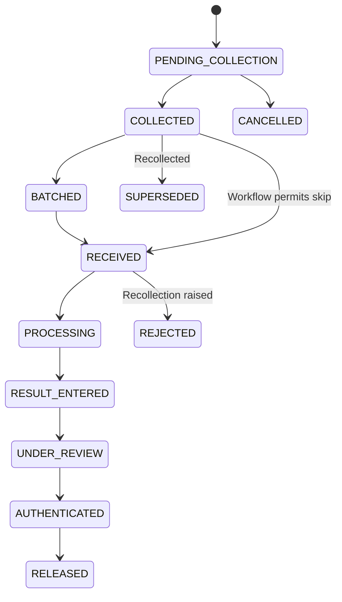
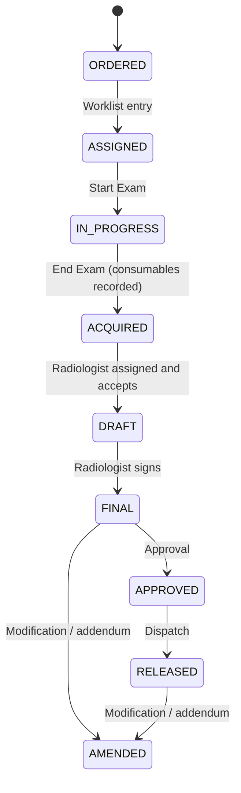

# Product Requirements Document
## AUXASOFTCARE — Enterprise LIS + RIS Platform

| Field | Value |
|---|---|
| Product | AUXASOFTCARE Enterprise LIS + RIS Platform |
| Document ID | AUXA-PRD-001 |
| Version | 1.1 |
| Status | Draft for review |
| Date | 23 November 2026 |
| Product owner | Auxano Global HealthCare |
| Classification | Confidential |
| Source documents | Enterprise LIS + RIS Architecture and Implementation Roadmap, `docs/ROADMAP_ALIGNMENT.md`, `README.md`, current codebase |

### Approvals

| Role | Name | Signature | Date |
|---|---|---|---|
| Executive sponsor, Auxano Global HealthCare | | | |
| Head of Product | | | |
| Head of Engineering / CTO | | | |
| Clinical Advisor — Laboratory Medicine | | | |
| Clinical Advisor — Radiology | | | |
| Head of Information Security | | | |
| Data Protection Officer | | | |

### Revision history

| Version | Date | Author | Summary |
|---|---|---|---|
| 1.0 | 2026-11-23 | Product / Engineering | First consolidated PRD, aligned to the Phase 1–7 build and the architecture roadmap |
| 1.1 | 2026-11-23 | Product / Engineering | Rebranded as AUXASOFTCARE by Auxano Global HealthCare; repositioned as a product for any diagnostic organisation, not a single client |

---

## Table of contents

1. Executive summary
2. Background and problem statement
3. Vision, goals and non-goals
4. Success metrics
5. Stakeholders, users and personas
6. Scope and release plan
7. Assumptions, constraints and dependencies
8. Functional requirements
9. Core business rules
10. Workflow and state models
11. Data model overview
12. Non-functional requirements
13. Integration requirements
14. Security, privacy and clinical governance
15. Deployment, environments and operations
16. Quality assurance and acceptance
17. Risks and mitigations
18. Open decisions
19. Glossary
20. Appendices

### Requirement conventions

Each requirement has a unique ID (`FR-<MODULE>-<NNN>` for functional, `NFR-<AREA>-<NNN>` for non-functional), a **priority** and a **build status**.

- **Priority (MoSCoW):** **M** = Must have for pilot · **S** = Should have · **C** = Could have · **W** = Won't have in this release.
- **Build status:** **Done** = implemented in the current build with automated tests · **Partial** = implemented in part or without full validation · **Planned** = not yet built.

"The system" means the central Django platform unless stated otherwise. "Shall" is mandatory; "should" is recommended.

---

## 1. Executive summary

**AUXASOFTCARE**, built by **Auxano Global HealthCare**, is an enterprise healthcare operations platform for diagnostic organisations. Target clients include independent laboratories, imaging centres, hospital laboratory and radiology departments, and multi-site diagnostic chains. Each client deployment runs one or many centres (for example a head office and several branches) under the client's own name, logo and report branding. It combines:

- **Laboratory Information System (LIS/LIMS):** registration, ordering, sample collection and barcoding, batching, department receiving, result entry, review, authentication, controlled release and quality control.
- **Radiology Information System (RIS) with PACS integration:** worklists, modality assignment, exam start/end, consumables tracking, structured rich-text reporting, radiologist signing, approval and dispatch.
- **Enterprise operations:** tariffs, billing, payments, discounts, refunds and bill amendments, HMO and corporate credit, referral commissions, inventory, notifications, portals, audit and management reporting.

The platform is a **modular Django monolith** with a REST API, Bootstrap 5 staff screens, patient/physician/corporate portals, a Flutter mobile client, and an **on-site Windows integration gateway** for laboratory analysers. It is deployed from GitHub to Railway with PostgreSQL.

This PRD sets out what the product must do, the business rules it must enforce, its quality standards, and what must be true before it can process real patient data.

---

## 2. Background and problem statement

Diagnostic organisations commonly run laboratory, radiology, front desk and finance on separate tools, spreadsheets and paper. AUXASOFTCARE addresses the problems this creates.

### 2.1 Current challenges

| # | Problem | Impact |
|---|---|---|
| P1 | Patient identity, visits and samples are tracked inconsistently across centres | Duplicate patients, mislabelled samples, weak traceability |
| P2 | Results can be released without every precondition being met (documents, payment, authentication) | Clinical and legal risk, revenue leakage |
| P3 | Bills can be changed after work has been done, without a reliable audit trail | Financial loss, fraud exposure, reconciliation failures |
| P4 | Workflows differ by discipline (routine, cytology, microbiology, histology, radiology) and are not enforced | Skipped steps, inconsistent quality |
| P5 | Turnaround time (TAT) and pending work are not visible | Missed SLAs, no escalation |
| P6 | Referral commissions are calculated manually | Disputes, duplicate or missed payouts |
| P7 | Analysers and modalities are not integrated | Transcription errors, slower TAT |
| P8 | Management lacks reliable, centre-level financial and operational reporting | Poor decisions, unreliable totals |

### 2.2 Opportunity

A single platform that is the **source of truth** for patient identity, visits, orders, billing and authorised results. It enforces clinical and financial controls on the server and records every significant action in an audit trail.

---

## 3. Vision, goals and non-goals

### 3.1 Vision

> For every AUXASOFTCARE client, every patient, sample, image, result and payment is traceable from registration to release, across every centre, under controls the organisation can prove.

### 3.2 Goals

| ID | Goal |
|---|---|
| G1 | One persistent patient identity (UHID) across all centres, with separate Visit IDs and Sample IDs |
| G2 | Server-enforced clinical workflows for laboratory and radiology, with full sample-to-result traceability |
| G3 | Controlled result release: required documents, authentication or approval, financial clearance and permission |
| G4 | Financial integrity: balanced invoices, auditable amendments and refunds, no editing of resulted work |
| G5 | Centre-scoped role-based access, with every sensitive action audited |
| G6 | Real-time operational visibility: pending results, TAT, overdue work, radiology performance |
| G7 | Accurate, ledger-based referral commissions and controlled settlements |
| G8 | Safe, idempotent analyser and PACS integration that never bypasses validation |
| G9 | Secure self-service portals for patients, referring physicians and corporate clients |
| G10 | A reusable product: each client organisation is configured (branding, centres, catalogue, tariffs, roles, workflows, templates) without code changes |

### 3.3 Non-goals for this release

- Electronic Medical Record (EMR) or clinical consultation notes.
- Pharmacy dispensing and point-of-sale for non-diagnostic goods.
- Building a full DICOM diagnostic viewer. An approved external viewer or PACS viewer is used instead.
- Payroll, general ledger and full ERP accounting. The platform feeds finance reporting but is not the accounting system of record.
- Breaking the system into microservices. It stays a modular monolith until a measured need emerges.
- Insurance claims adjudication (beyond HMO tariffs, credit accounts and statements).

---

## 4. Success metrics

Baselines are captured during each client's pilot. Targets apply from three months after go-live at that client's pilot centre.

| ID | Metric | Target |
|---|---|---|
| KPI-01 | Results released without all release conditions met | 0 |
| KPI-02 | Duplicate Visit ID or Sample ID generated | 0 |
| KPI-03 | Bill edits, cancellations or refunds on resulted tests | 0 (blocked by the system) |
| KPI-04 | Invoices where subtotal ≠ sum of line items | 0 |
| KPI-05 | Routine laboratory tests released within configured TAT | ≥ 90% |
| KPI-06 | Radiology reports signed within configured TAT | ≥ 85% |
| KPI-07 | Sample rejection or recollection rate | Tracked; downward trend quarter-on-quarter |
| KPI-08 | Referral commission disputes | ≥ 50% reduction from baseline |
| KPI-09 | Duplicate patient records created per month | ≥ 80% reduction from baseline |
| KPI-10 | Platform availability during centre operating hours | ≥ 99.5% |
| KPI-11 | Analyser messages that create a duplicate clinical result | 0 |
| KPI-12 | Staff trained and active on the platform at the pilot centre | 100% of in-scope roles |

---

## 5. Stakeholders, users and personas

### 5.1 Stakeholders

| Stakeholder | Interest |
|---|---|
| Auxano Global HealthCare (product owner) | Product quality, roadmap, client adoption, support, compliance |
| Client executive management | Revenue, growth, centre performance, risk |
| Medical / Laboratory Director | Clinical quality, authentication authority, QC |
| Head of Radiology | Reporting quality, radiologist productivity, PACS |
| Finance / Accounts | Billing integrity, collections, refunds, HMO and corporate receivables, commissions |
| IT / Information Security | Availability, security, integrations, backups |
| Data Protection Officer | NDPA 2023 compliance, consent, data-subject requests |
| Referring physicians and partners | Referral visibility, earnings, settlements |
| Patients | Convenient registration, timely and secure access to results |

### 5.2 System roles

These are seeded by `seed_roles`. Administrators can create custom roles in the UI. The full privilege list is in Appendix A.

| Role | Primary responsibilities |
|---|---|
| Platform Administrator | Organisation setup, users, roles, catalogue, templates, integrations, audit; full privileges |
| Centre Administrator | Centre-level user access, patient data corrections, bill edit, refunds, support |
| Front Desk | Patient registration, visits, documents, referring doctor selection |
| Cashier | Payments, receipts, invoice reprints |
| Accounts | Discounts, refunds, bill edits, reversals, referral settlements, financial reports |
| Phlebotomist | Sample collection, labels, recollection |
| Laboratory Scientist | Receiving, processing, result entry |
| Lab Manager | Review, authentication, release, amendment and dispatch of laboratory results; QC |
| Radiographer | Exam start/end, consumables used, radiologist assignment |
| Radiologist | Reporting, signing, modification, addenda, authorised substitution |
| Referral Doctor | Physician portal: referrals, ledger, withdrawals |
| Auditor | Read-only access to audit, patients, visits and finance |
| Patient (portal) | Profile, visits, receipts, released results, preferences, support |
| Corporate client (portal) | Statements, invoices, authorised patient listings |

### 5.3 Key personas

- **Ada — Front Desk Officer, branch centre.** Registers 80–150 patients a day. Needs fast phone lookup, duplicate warnings, tariff-correct pricing, and document scanning. Must not be able to release results.
- **Chinedu — Laboratory Scientist.** Works from barcoded samples. Needs a clean worklist, analyser results arriving automatically, and clear review queues.
- **Dr. Okafor — Consultant Radiologist.** Reports remotely across centres. Needs a full-width reporting desk, configurable section order, templates, a stored signature, and a fast sign → approve → dispatch path.
- **Ngozi — Head of Accounts.** Needs balanced bills, controlled refunds, an amendment history, HMO statements and referral payout control.
- **Management.** Needs trustworthy dashboards by period and centre, exportable and access-controlled.

---

## 6. Scope and release plan

### 6.1 In scope

All modules in Section 8 across the seven roadmap phases.

### 6.2 Release phases

| Phase | Theme | Acceptance criteria | Status |
|---|---|---|---|
| 01 | Foundation: auth, RBAC, centres, audit, deployment | Secure login, centre switching, enforced API permissions, automated tests, staging deployment | Done |
| 02 | Registration and billing | Concurrent registrations cannot create duplicate IDs; payments reconcile; missing prices and documents handled | Done |
| 03 | Core LIS workflow | Complete sample-to-result traceability; server-enforced transitions | Done |
| 04 | RIS and PACS | Prevents unauthorised reporting; studies, reports and statuses reconcile | Done (PACS: Partial) |
| 05 | Referral and patient portals | Commission adjustments traceable; no cross-patient portal access | Done |
| 06 | Local analyser gateway | Verified device comms, duplicate protection, offline recovery with real instrument messages | Partial (vendor certification outstanding) |
| 07 | Enterprise reporting and hardening | Signed-off UAT, monitoring, tested recovery, documented release procedure | Partial (security testing, DR drill, UAT outstanding) |

### 6.3 Pilot

Each new client starts with one pilot centre, agreed with that client (see Section 18). The client's other centres roll out after pilot sign-off. The first reference deployment is selected by Auxano Global HealthCare.

---

## 7. Assumptions, constraints and dependencies

**Assumptions**
- Each centre has reliable power and internet, with a fallback (UPS or generator, secondary ISP or 4G).
- Each laboratory centre provides a dedicated Windows PC for the integration gateway.
- Each client's laboratory and radiology leadership approves its clinical workflows, reference ranges and authentication authority before activation.
- Each client's management approves its commission rules, tax treatment and payout policy.

**Constraints**
- The initial market is Nigeria. This release uses Nigerian Naira (₦) and displays times in **Africa/Lagos**; other currencies and timezones are a future requirement. Monetary values use decimal arithmetic only.
- Timestamps are stored in UTC.
- The hosted platform (Railway) cannot reach USB or private-network devices directly. All device traffic goes through the on-site gateway.
- Sample ID sequences have five digits (99,999 values per centre/department/service-group combination). Rollover behaviour must be defined before production.

**Dependencies**
- PostgreSQL (production), Redis (Celery broker), S3-compatible object storage (documents and reports).
- Email (SMTP), SMS and WhatsApp providers.
- Orthanc or an existing PACS; DICOM-capable modalities.
- Analyser vendor protocol documentation and licences.

---

## 8. Functional requirements

### 8.1 Identity, authentication and access (`core`)

| ID | Requirement | Pri | Status |
|---|---|---|---|
| FR-AUTH-001 | Users sign in with username and password; API clients use JWT (short-lived access token, refresh token) | M | Done |
| FR-AUTH-002 | Passwords must be at least 12 characters and pass Django's common, similar-to-user and numeric validators | M | Done |
| FR-AUTH-003 | Accounts lock after a configurable number of failed sign-ins (default **3**) and stay locked until an administrator unlocks them | M | Done |
| FR-AUTH-004 | Self-service password reset by email, using single-use, time-limited tokens | M | Done |
| FR-AUTH-005 | Optional TOTP multi-factor authentication for privileged users; mandatory for Platform Administrators before production | M | Partial |
| FR-AUTH-006 | Idle sessions are signed out after an organisation-configurable timeout (default **10 minutes**, range 0–1440; 0 disables) with a warning before logout | M | Done |
| FR-AUTH-007 | Sessions expire after 8 hours and at browser close (both configurable) | M | Done |
| FR-AUTH-008 | Users can change their password and maintain a profile and a **digital signature image** used on signed reports | M | Done |
| FR-RBAC-001 | Access combines **role** (group), **granular privilege** (permission), **centre assignment** and **scope** | M | Done |
| FR-RBAC-002 | Centre access grants are per user and per centre: `can_view`, `can_register`, `can_edit`, `can_approve` | M | Done |
| FR-RBAC-003 | Every API and screen enforces permissions on the server. Hiding a button is never the only control | M | Done |
| FR-RBAC-004 | Administrators create and edit roles in the UI; privilege changes apply to all holders immediately | M | Done |
| FR-RBAC-005 | Navigation shows only the workspaces a user is entitled to | S | Done |
| FR-ORG-001 | Organisation profile: legal name, short name, tagline, logo, report formats, result watermark, idle timeout | M | Done |
| FR-ORG-002 | Centres with code, prefix, phones, bank accounts and report format; a unique one-digit sample code per centre | M | Done |
| FR-ORG-003 | **White-label per client:** the client's legal name, short name, logo, letterheads, report formats and watermark appear on screens, receipts, invoices and result reports; AUXASOFTCARE branding is limited to the sign-in page and "Powered by" footer | M | Partial |
| FR-ORG-004 | **Client onboarding kit:** seed roles, notification templates and workflows; bulk-upload the catalogue, tariffs and clients; set up centres and sample codes, with a go-live checklist | M | Partial |

### 8.2 Patient registration and visits (`patients`)

| ID | Requirement | Pri | Status |
|---|---|---|---|
| FR-PAT-001 | Generate a persistent, system-assigned **UHID** per patient. The phone number assists matching but never defines the UHID | M | Done |
| FR-PAT-002 | Look up patients by phone and warn about possible duplicates before creating a new record | M | Done |
| FR-PAT-003 | Capture demographics: title, names, sex, date of birth, phone, email, address, guardian (for minors), client type, registration channel | M | Done |
| FR-PAT-004 | Capture preferred communication channels (email, SMS, WhatsApp) and consent | M | Done |
| FR-PAT-005 | Each registration creates a **Visit** with a centre-specific Visit ID: centre prefix plus a 7-digit sequence (e.g. `ABC0000001`) | M | Done |
| FR-PAT-006 | Upload or scan referral and registration documents to protected storage, linked to patient and visit, with type, uploader, timestamp and integrity metadata | M | Done |
| FR-PAT-007 | Select the referring physician at registration, including `SELF` and `DEFAULT REF DOC` | M | Done |
| FR-PAT-008 | Changing a referring doctor requires a reason, a note and a mandatory supporting attachment; the previous attribution is kept | M | Done |
| FR-PAT-009 | Demographic changes require `can_modify_patient_data` and are audited with previous and new values | M | Done |
| FR-PAT-010 | Patient timeline and visit audit trail screens show every event from registration to release | M | Done |
| FR-PAT-011 | Corporate, HMO and organisation clients with credit wallet ledgers | M | Done |
| FR-PAT-012 | Bulk upload of master data (clients, tariffs, catalogue) with validation and error reporting | S | Done |

### 8.3 Catalogue and tariffs (`laboratory`, `radiology`, `core`)

| ID | Requirement | Pri | Status |
|---|---|---|---|
| FR-CAT-001 | Test catalogue: code, name, department, service group, specimen type, container, volume, handling, STAT type, TAT target, result template, workflow | M | Done |
| FR-CAT-002 | Imaging procedure catalogue by modality (X-ray, CT, MRI, ultrasound, mammography, etc.) | M | Done |
| FR-CAT-003 | Tariff engine: Standard, HMO, corporate and other approved schedules, with a price per test or procedure and optional outsourcing cost | M | Done |
| FR-CAT-004 | Show an explicit warning and block billing when a test has no price on the selected tariff | M | Done |
| FR-CAT-005 | Tariff changes are recorded in a tariff activity history; tariffs can be uploaded in bulk | M | Done |
| FR-CAT-006 | Retain historical prices on invoice lines; later tariff changes never rewrite issued invoices | M | Done |

### 8.4 Billing, payments and financial controls (`billing`)

| ID | Requirement | Pri | Status |
|---|---|---|---|
| FR-BIL-001 | Generate an invoice per visit, with one line per test or procedure linked to its lab or imaging order | M | Done |
| FR-BIL-002 | Record payments (cash, transfer, POS, etc.) with receipt numbers; receipts and invoices can be reprinted (privileged) | M | Done |
| FR-BIL-003 | For HMO and credit clients, distinguish an invoice or credit receipt from evidence of money received; the payer is the organisation | M | Done |
| FR-BIL-004 | Discounts follow **request → approve/reject → payment**; approvers receive an in-app notification | M | Done |
| FR-BIL-005 | Confirmed payments are never deleted or overwritten; corrections use reversals or refunds | M | Done |
| FR-BIL-006 | **Bill edit** (privilege `bill_edit` / `bill_modify`): remove a test or replace it with another; totals are recalculated; a reason is mandatory; every change creates a Bill Amendment and an audit event | M | Done |
| FR-BIL-007 | **Bill edit lock:** a test that has been resulted or approved cannot be edited. The system rejects the request with *"This bill cannot be edited. The bill has been resulted already."* and the screen shows a locked state | M | Done |
| FR-BIL-008 | **Cancel / refund** (privilege `payment_refund`): cancel a single test, or cancel and refund it, capped to the net amount actually collected; the linked order, samples and exam are cancelled | M | Done |
| FR-BIL-009 | **Refund lock:** a resulted test cannot be cancelled or refunded; the system shows *"This test cannot be cancelled or refunded. The bill has been resulted already."* | M | Done |
| FR-BIL-010 | After any adjustment, the invoice subtotal must equal the sum of its lines, or the transaction is rolled back | M | Done |
| FR-BIL-011 | Bill amendments and refunds automatically recalculate referral commissions | M | Done |
| FR-BIL-012 | Accounts workspace (paypoint), financial reports and audited exports | M | Done |
| FR-BIL-013 | Invoice cancellation and payment reversal require dedicated privileges and a reason | M | Done |

### 8.5 Sample management (`laboratory`)

| ID | Requirement | Pri | Status |
|---|---|---|---|
| FR-SMP-001 | Phlebotomy workspace: pending collections per visit, patient summary, and access to the registration form | M | Done |
| FR-SMP-002 | Sample ID = centre digit + department digit + service-group digit + 5-digit sequence, generated atomically from database counters | M | Done |
| FR-SMP-003 | Print Code 128 barcode labels; keep a print history | M | Done |
| FR-SMP-004 | Record collector, collection time, centre, specimen type, IP address and browser | M | Done |
| FR-SMP-005 | Batch samples, dispatch batches between centres, and receive them with accept/reject disposition | M | Done |
| FR-SMP-006 | Recollection creates a new sample linked to the original; the original is marked rejected, unsuitable or superseded, and its history is kept | M | Done |
| FR-SMP-007 | Each sample has a complete activity timeline: collection, barcode, batch, receiving, processing, rejection | M | Done |

### 8.6 Laboratory results and quality (`laboratory`, `workflows`)

| ID | Requirement | Pri | Status |
|---|---|---|---|
| FR-LAB-001 | Result templates with parameters: numeric (units, decimals, reference interval), text, single/multi-select, qualitative, tables, calculated values, comments | M | Done |
| FR-LAB-002 | Reference ranges by age and sex; never hard-coded in the frontend | M | Done |
| FR-LAB-003 | Templates are versioned; each authenticated result keeps a snapshot of the template, parameters and ranges used | M | Done |
| FR-LAB-004 | Result lifecycle: Draft → Submitted → Reviewed → Authenticated → Released, with Amended for post-release changes. Transitions are enforced on the server | M | Done |
| FR-LAB-005 | Review, authentication, release, amendment and dispatch each need their own privilege; the person who enters a result cannot authenticate it unless policy allows | M | Done |
| FR-LAB-006 | Versioned workflow definitions (routine, cytology, microbiology, histology) are bound to each order at creation; later changes never rewrite in-progress orders | M | Done |
| FR-LAB-007 | Visual drag-and-drop workflow builder with preview and publish | S | Planned |
| FR-LAB-008 | QC materials, targets and runs, with a QC workspace | M | Done |
| FR-LAB-009 | Critical-value rules with mandatory comment and notification | S | Partial |
| FR-LAB-010 | Laboratory batch reports and printable result reports with organisation branding and watermark | M | Done |

### 8.7 Turnaround time (TAT)

| ID | Requirement | Pri | Status |
|---|---|---|---|
| FR-TAT-001 | TAT rules per test or service, with a configurable clock start (e.g. payment) and end (e.g. release) | M | Done |
| FR-TAT-002 | Clock pauses for documented reasons | M | Done |
| FR-TAT-003 | Escalations for overdue work by centre, department and role | M | Done |
| FR-TAT-004 | TAT dashboard showing time per stage and total TAT; separate timestamps for entry, review, authentication and release | M | Done |
| FR-TAT-005 | **Pending results report** across laboratory and radiology, filterable by centre, period and status | M | Done |

### 8.8 Radiology (`radiology`)

| ID | Requirement | Pri | Status |
|---|---|---|---|
| FR-RAD-001 | Modality rooms are configured per centre; imaging orders create a RIS worklist entry | M | Done |
| FR-RAD-002 | Exam lifecycle: Assigned → In progress → Acquired; Start Exam and End Exam are recorded with user and time | M | Done |
| FR-RAD-003 | **Consumables used** during an exam must be selected from inventory, and are required before ending an exam or assigning a radiologist | M | Done |
| FR-RAD-004 | Assign a reporting radiologist; radiologists accept assignments; authorised substitution follows a controlled policy | M | Done |
| FR-RAD-005 | Only the assigned radiologist (or an authorised substitute) may edit an unsigned report; this is checked against the actual exam state on the server | M | Done |
| FR-RAD-006 | **Full-width reporting desk** with image viewer, template selector and a **dynamic sequence of sections** (Clinical Information, Comparison, Technique, Findings, Impression, Conclusion, Follow-Up, plus custom items); sections can be added, removed and reordered | M | Done |
| FR-RAD-007 | Each section has a full rich-text toolbar (formatting, lists, alignment, tables) with character and word counts | M | Done |
| FR-RAD-008 | **Template builder** for radiologists and Platform Administrators uses the same sequenced-section editor; templates are versioned (draft, published, retired), support variants and are scoped by modality and procedure | M | Done |
| FR-RAD-009 | Report lifecycle: Draft → Final (signed) → Approved → Released (dispatched), with Amended for post-sign changes; revision snapshots are kept | M | Done |
| FR-RAD-010 | Signed changes require a formal amendment or addendum, with a mandatory "Reason for Modification" and an audit trail | M | Done |
| FR-RAD-011 | **PDF report:** organisation header; modality title (never the procedure name in the header block); sections with headings, rules and consistent spacing; signature image directly under the radiologist's name, then title, qualifications and signed date; no internal data in the output | M | Done |
| FR-RAD-012 | Radiology performance and statistics, with export | M | Done |
| FR-RAD-013 | Exam files and attachments stored as references; large image data stays in PACS | M | Done |

### 8.9 Result modification and dispatch (`core.result_control`)

| ID | Requirement | Pri | Status |
|---|---|---|---|
| FR-RES-001 | A single **Modify** desk for authorised laboratory and radiology users, with reason capture and history export (CSV, PDF, Excel) | M | Done |
| FR-RES-002 | A single **Dispatch** desk: record recipient, collector identity and identification document; every dispatch is written to the Result Ledger | M | Done |
| FR-RES-003 | Release or dispatch is permitted only when **all** release-eligibility conditions are met (Section 9.3); the API rejects ineligible requests even if the UI is bypassed | M | Done |
| FR-RES-004 | Dispatch history export with audit of who exported | M | Done |

### 8.10 Inventory (`inventory`)

| ID | Requirement | Pri | Status |
|---|---|---|---|
| FR-INV-001 | SKU master for reagents and consumables, with units, reorder levels and centre | M | Done |
| FR-INV-002 | Stock movements (receipt, issue, adjustment, wastage, expiry), with balances derived from movements | M | Done |
| FR-INV-003 | Radiology consumables use issues stock automatically | M | Done |
| FR-INV-004 | Low-stock and expiry alerts | S | Partial |
| FR-INV-005 | Reports on inventory usage, wastage and expiry | S | Done |

### 8.11 Referrals and commissions (`referrals`)

| ID | Requirement | Pri | Status |
|---|---|---|---|
| FR-REF-001 | Register referral doctors and institutions; onboard physicians with single-use, time-limited email invitations (never a plain-text password) | M | Done |
| FR-REF-002 | Ledger-based commissions: record the rule and amount when earned; reverse or adjust them on cancellation, refund or replacement; prevent duplicate commissions | M | Done |
| FR-REF-003 | Withdrawal workflow: **Requested → Processing → Paid/Settled**, with **Declined** as an alternative; the 7-day rule is enforced on the server | M | Done |
| FR-REF-004 | Settlement requires recorded payout, mandatory proof-of-payment upload and a note | M | Done |
| FR-REF-005 | Accounts Head and Manager are notified of withdrawal requests; the physician is notified of payout | M | Done |
| FR-REF-006 | Referral hub: doctors, commission, referred visits, payouts and export | M | Done |

### 8.12 Portals (`portals`)

| ID | Requirement | Pri | Status |
|---|---|---|---|
| FR-POR-001 | **Patient portal** login with UHID and date of birth; minors also need the guardian phone; a phone number alone never opens every matching record | M | Done |
| FR-POR-002 | Patient portal shows profile, visits, invoices, receipts, released results and downloads, notification preferences and support/correction requests | M | Done |
| FR-POR-003 | **Physician portal:** invitation-based activation, referral history, commission ledger and withdrawals; clinical result visibility is governed by consent and policy | M | Done |
| FR-POR-004 | **Corporate portal:** statements, invoices, credit balance and authorised patient listings | M | Done |
| FR-POR-005 | Result links in messages are short-lived tokens that require authentication | M | Done |
| FR-POR-006 | Staff support desk with case types, case history, assignment and export | M | Done |

### 8.13 Notifications (`communications`)

| ID | Requirement | Pri | Status |
|---|---|---|---|
| FR-NOT-001 | Outbox-based delivery over email, SMS and WhatsApp, respecting consented channels, with retry and status tracking | M | Done |
| FR-NOT-002 | Event catalogue: registration, referral received, payment receipt, discount request/decision, recollection, result authenticated, result ready, withdrawal request, payout settled, integration failure | M | Done |
| FR-NOT-003 | Templates with variables (e.g. `{{ patient_name }}`, `{{ visit_id }}`, `{{ result_link }}`); variables are validated before a template can be published | M | Done |
| FR-NOT-004 | Messages never contain passwords or result values | M | Done |
| FR-NOT-005 | In-app notification inbox and live feed for staff | M | Done |
| FR-NOT-006 | Production SMS and WhatsApp provider runtime certification | M | Planned |

### 8.14 Reporting and analytics (`reporting`)

| ID | Requirement | Pri | Status |
|---|---|---|---|
| FR-RPT-001 | Management dashboard with period and centre filters: Financial, Clinical operations, Centres, Referral network | M | Done |
| FR-RPT-002 | Report catalogue: revenue by patient, physician, partner, centre, department, service group and test; HMO statements; commissions; demographics; radiology volumes; inventory | M | Done |
| FR-RPT-003 | Every financial metric is precisely defined (gross charges, discounts, refunds, net revenue, cash collected, receivables) and never mixed under one label | M | Done |
| FR-RPT-004 | All figures are derived from transactional records; no separate editable totals | M | Done |
| FR-RPT-005 | Excel and PDF exports apply the same centre and role restrictions as the screens, are audited, and run in the background when large | M | Done |

### 8.15 Integrations (`integrations`, `gateway`)

| ID | Requirement | Pri | Status |
|---|---|---|---|
| FR-INT-001 | Register gateways per centre and department with gateway-specific API credentials | M | Done |
| FR-INT-002 | Register analysers and map test and result codes to the central catalogue | M | Done |
| FR-INT-003 | Store every inbound message raw; detect duplicates with an idempotency key; quarantine unmapped or suspicious results for review | M | Done |
| FR-INT-004 | Integration review screen to accept, reject or re-map messages | M | Done |
| FR-INT-005 | Gateway: durable SQLite queue, retry with backoff, localhost-only configuration UI, file-drop (HL7) agent | M | Done |
| FR-INT-006 | Adapter contract (`connect`, `health_check`, `receive_message`, `parse_message`, `map_test_codes`, `submit_result`, `acknowledge_message`) with an ASTM adapter | M | Partial (skeleton) |
| FR-INT-007 | Per-analyser vendor certification with real instrument messages | M | Planned |
| FR-INT-008 | Orthanc PACS client, study metadata, reconciliation and failure queue | M | Done |
| FR-INT-009 | DICOM Modality Worklist and approved image-viewer launch | S | Partial |

### 8.16 Audit (`core`)

| ID | Requirement | Pri | Status |
|---|---|---|---|
| FR-AUD-001 | Record user, action, UTC timestamp, centre, patient/visit/order/result reference, previous and new values, reason, IP address and browser for every significant event | M | Done |
| FR-AUD-002 | Audit events cannot be edited or deleted through the application | M | Done |
| FR-AUD-003 | Audit viewer filterable by category (billing, clinical, security, admin), user, centre and period, with export | M | Done |
| FR-AUD-004 | Audit captures request metadata, never request bodies or passwords | M | Done |

---

## 9. Core business rules

### 9.1 Identifiers

| Identifier | Format | Scope | Rule |
|---|---|---|---|
| UHID | System-generated | Organisation | One per patient across all centres; never derived from the phone number |
| Visit ID | `<CentrePrefix><7 digits>` e.g. `ABC0000001` | Per centre | Separate sequence per centre; generated atomically; unique |
| Sample ID | `<centre><dept><group><5 digits>` e.g. `21300001` | Per centre/department/group | Generated atomically; unique; rollover policy to be defined |
| Invoice / Receipt no. | System-generated | Organisation | Unique; never reused |

### 9.2 What counts as "resulted"

Used by the bill edit and refund locks.

- **Laboratory line:** the order is Completed, **or** any sample is at Result entered / Under review / Authenticated / Released, **or** any result is Submitted / Reviewed / Authenticated / Released / Amended.
- **Radiology line:** the imaging order is Completed, **or** the report is Final / Approved / Released / Amended.
- Draft results and draft reports are **not** resulted.

### 9.3 Release eligibility

A result or report can be released or dispatched only when **all** of these are true:

1. At least one acceptable required document (referral or registration form) is attached to the visit. A generic "other" attachment does not count.
2. The applicable workflow is complete, with no mandatory step skipped.
3. The result is authenticated (laboratory) or the report is signed and approved (radiology).
4. Outstanding financial restrictions are resolved: paid, or covered by approved credit.
5. The user holds the release or dispatch privilege for that discipline and centre.

The screen shows what is blocking release, and the API independently refuses ineligible requests.

### 9.4 Financial rules

- Money uses decimal types only; never floating point.
- After every change, the invoice subtotal must equal the sum of its lines.
- Refunds are capped at net confirmed collections.
- Resulted tests cannot be edited, cancelled or refunded (see 9.2).
- Every amendment, refund, reversal and discount decision needs a reason and is audited.
- Commission recalculates on every invoice change; there are no duplicate commission events.

### 9.5 Clinical authority

Who may enter, review, authenticate, approve and release each category of result is set by each client's clinical governance and configured as privileges. The software enforces that policy; it does not infer authority from job title alone.

---

## 10. Workflow and state models

### 10.1 Laboratory result

### 10.2 Sample

### 10.3 Radiology exam and report

### 10.4 Discount, referral withdrawal and bill edit

- **Discount:** Requested → Approved or Rejected → payment completed at the approved amount.
- **Withdrawal:** Requested → Processing → Paid/Settled (proof required) | Declined.
- **Bill edit / refund:** select line → system checks the resulted lock → reason → atomic change → amendment or refund record → commission sync → audit.

---

## 11. Data model overview

| Domain | Key entities |
|---|---|
| Organisation and security | User, Centre, CentrePhone, CentreBank, CentreReportFormat, UserCentreAccess, OrganizationProfile, SequenceCounter, AuditEvent, ResultLedger |
| Patients | Patient, PatientTitle, Visit, PatientDocument, ClientType, RegistrationChannel, OrganisationClient, CreditWalletLedger |
| Catalogue | ServiceGroup, SpecimenType, ContainerType, StatType, Test, Tariff, TestPrice, TariffActivity, ImagingProcedure, ImagingPrice |
| Laboratory | LabOrder, SampleCodeConfig, Sample, SampleActivity, SampleBarcodePrint, SampleBatch, BatchSample, SampleProcessing, TestParameter, ResultTemplate, ResultTemplateField, ReferenceRange, LabResult, ResultValue, ResultReview, QcMaterial, QcTarget, QcRun |
| TAT | TatRule, TatPauseReason, TatPause, TatEscalation |
| Workflows | WorkflowDefinition, WorkflowAssignment, WorkflowStep, WorkflowTransition, OrderWorkflowInstance, OrderWorkflowEvent |
| Radiology | ImagingModality, ImagingOrder, RadiologyExam, ExamSupplyUse, RadiologistAcceptRecord, RadiologyDeskSetting, RadiologyExamActivity, RadiologyReportTemplate, RadiologyReport, RadiologyReportRevision, ImagingFile, PacsFailure |
| Billing | Invoice, InvoiceItem, Payment, DiscountRequest, BillAmendment, Refund |
| Referrals | ReferralDoctor, ReferralInstitution, ReferralAttribution, CommissionLedgerEntry, WithdrawalRequest |
| Portals | PortalAccessToken, PhysicianInvite, SupportRequestType, PortalRequest, SupportEvent |
| Communications | NotificationTemplate, NotificationOutbox, AppNotification |
| Inventory | ReagentSku, StockMovement |
| Integrations | GatewayRegistration, Analyzer, AnalyzerTestMapping, AnalyzerMessage |

**Design rules:**
- UUID primary keys for internal entities, alongside human-readable business IDs.
- Business identifiers are unique at database level.
- Explicit status fields with validated transitions.
- Historical versions of tariffs, templates and workflows are kept.
- Soft cancellation or reversal instead of deletion for clinical and financial records.

---

## 12. Non-functional requirements

### 12.1 Security

| ID | Requirement |
|---|---|
| NFR-SEC-001 | HTTPS only in production; HSTS enabled (1 year); secure, HttpOnly, SameSite cookies; CSRF protection |
| NFR-SEC-002 | Secrets come from environment variables or a secrets manager; the application refuses to start in production without `DJANGO_SECRET_KEY` and `DATABASE_URL` |
| NFR-SEC-003 | API rate limiting (baseline: 30/min anonymous, 180/min authenticated) and login lockout |
| NFR-SEC-004 | Object-level and centre-level authorisation on every API endpoint and file download |
| NFR-SEC-005 | Uploaded documents are stored privately, served only through authorised views, and scanned for malware before production |
| NFR-SEC-006 | JWT access tokens last 10 minutes by default; refresh tokens rotate |
| NFR-SEC-007 | MFA is mandatory for Platform Administrators and recommended for finance and release privileges |
| NFR-SEC-008 | Dependency vulnerability scanning in CI; critical issues fixed before release |
| NFR-SEC-009 | Independent penetration test before go-live and annually after |
| NFR-SEC-010 | Proxy IP headers are trusted only when explicitly configured |

### 12.2 Performance and scalability (targets to be validated at pilot)

| ID | Requirement |
|---|---|
| NFR-PERF-001 | 95th-percentile page and API response ≤ 1.5 s for worklists and registration at pilot load |
| NFR-PERF-002 | Support ≥ 150 concurrent staff users and ≥ 5,000 visits per day across centres without degradation |
| NFR-PERF-003 | PDF report generation ≤ 3 s per report; bulk exports run in the background |
| NFR-PERF-004 | Lists are paginated; indexes are added on measured slow queries |

### 12.3 Availability, backup and recovery

| ID | Requirement |
|---|---|
| NFR-AVL-001 | ≥ 99.5% availability during operating hours; `/healthz` endpoint checks database connectivity |
| NFR-AVL-002 | Automated daily database backups, kept at least 30 days; point-in-time recovery where the host supports it |
| NFR-AVL-003 | Recovery point objective (RPO) ≤ 24 h (target 1 h); recovery time objective (RTO) ≤ 4 h |
| NFR-AVL-004 | Restore rehearsal before go-live and quarterly after |
| NFR-AVL-005 | The gateway works offline and queues messages until the central system confirms acceptance |

### 12.4 Auditability and data integrity

| ID | Requirement |
|---|---|
| NFR-AUD-001 | Business audit trail is append-only and kept in line with the retention policy (Section 14) |
| NFR-AUD-002 | Identifier generation is concurrency-safe on PostgreSQL (verified by tests) |
| NFR-AUD-003 | Financial and clinical changes that span several records run inside a single database transaction |

### 12.5 Usability and accessibility

| ID | Requirement |
|---|---|
| NFR-UX-001 | Responsive Bootstrap 5 UI, usable on desktop at 1366×768 and above; key screens usable on tablet |
| NFR-UX-002 | Role-based navigation; only entitled workspaces are shown |
| NFR-UX-003 | Blocking errors explain the reason and the next step (e.g. "The bill has been resulted already.") |
| NFR-UX-004 | Aim for WCAG 2.1 AA: keyboard navigation, contrast, labels on form fields |
| NFR-UX-005 | Unsaved-change protection on editors (reporting desk, template builder) |
| NFR-UX-006 | Branding (logo, legal name, watermark) is configurable without code changes |

### 12.6 Localisation

| ID | Requirement |
|---|---|
| NFR-L10N-001 | English (Nigeria); ₦ currency formatting with 2 decimals |
| NFR-L10N-002 | Africa/Lagos display timezone; stored in UTC |
| NFR-L10N-003 | Nigerian phone number formats supported in lookup and messaging |

### 12.7 Maintainability

| ID | Requirement |
|---|---|
| NFR-MNT-001 | Modular Django apps with clear ownership; no cross-app writes that bypass service functions |
| NFR-MNT-002 | Migrations committed and applied in a controlled pre-deploy step; `makemigrations --check` in CI |
| NFR-MNT-003 | Automated test suite (currently ~190 test cases) must pass before merge; coverage grows with each feature |

---

## 13. Integration requirements

| System | Direction | Protocol | Requirement |
|---|---|---|---|
| Laboratory analysers | Device → Gateway → Platform | ASTM, HL7 v2, serial, vendor TCP, file drop | Raw message kept; idempotent; mapped codes only; quarantine exceptions; never authenticates results automatically |
| On-site gateway | Gateway ↔ Platform | HTTPS REST with gateway API key | Durable queue; retry with backoff; acknowledgement; clock sync; disconnection alert |
| PACS (Orthanc) | Platform ↔ PACS | REST / DICOM | Study metadata, reconciliation, failure queue; images stay in PACS |
| Modalities | PACS / MWL | DICOM, MWL | Worklist where the equipment supports it |
| Email | Platform → SMTP | SMTP/TLS | Transactional mail; timeouts; no sensitive content |
| SMS / WhatsApp | Platform → Provider | HTTPS API | Consented channels only; delivery status captured |
| Object storage | Platform ↔ S3 | S3 API | Private bucket; server-side encryption; signed access |
| Mobile app | App ↔ Platform | REST + JWT | Same permissions as web |

---

## 14. Security, privacy and clinical governance

- **Regulation:** for Nigerian clients, the Nigeria Data Protection Act (NDPA) 2023 and applicable healthcare, professional and record-retention requirements. Clients in other jurisdictions require a local legal review. A formal legal assessment is required before each client goes live.
- **Roles:** each client organisation is the data controller for its patients' data; Auxano Global HealthCare acts as data processor where it hosts or supports the deployment, under a written data processing agreement.
- **Lawful basis and consent:** consent is recorded for communication channels; disclosure of results to physicians and corporates follows consent and policy.
- **Data minimisation:** notifications carry minimal information; management reports avoid unnecessary identifiers.
- **Data-subject rights:** access and correction requests through the patient portal and support desk; procedures for erasure where lawful.
- **Retention:** clinical, financial and audit retention periods to be set by each client's compliance function (proposed minimum: clinical records and audit 10 years; financial records 6 years).
- **Breach response:** documented incident response plan, with notification to the regulator within the statutory timeframe.
- **Access reviews:** quarterly review of privileged roles and centre grants.
- **Clinical governance:** an approved matrix of who may enter, review, authenticate and release each test category; workflows and templates approved by laboratory and radiology leadership before activation.
- **Synthetic data only** in development and test environments.

---

## 15. Deployment, environments and operations

| Environment | Purpose | Data |
|---|---|---|
| Local | Development (SQLite or Docker Postgres + Redis) | Synthetic |
| Staging (Railway) | Integration, UAT, smoke tests | Synthetic or anonymised |
| Production (Railway) | Live operations | Real, after sign-off |

**Pipeline:** feature branch → pull request (tests, `check`, `makemigrations --check`) → `main` → Railway build (Docker, `collectstatic`) → pre-deploy `migrate` → gunicorn on `$PORT` → `/healthz` health check.

**Operations requirements:**
- Separate credentials and databases per environment.
- Persistent object storage for media.
- Celery worker and beat run as separate processes.
- Monitoring and alerting for errors, latency, queue depth and gateway disconnection.
- Error alert emails to the IT on-call address.
- Documented rollback, recognising that schema changes may not be reversible.
- Release notes and a change approval for each production deployment.

---

## 16. Quality assurance and acceptance

### 16.1 Test strategy

| Category | Must cover |
|---|---|
| Identity | Duplicate patients, phone changes, concurrent Visit ID and Sample ID generation |
| Permissions | Cross-centre access, unauthorised result access, finance privileges |
| Billing | Duplicate payments, refunds, discounts, bill amendments, resulted-test locks, balanced totals |
| Samples | Barcode uniqueness, recollection links, batch reconciliation |
| Clinical workflow | Missing documents, skipped steps, review and authentication restrictions |
| Radiology | Start/end enforcement, consumables requirement, radiologist assignment, signed-report amendments, PDF layout |
| Referrals | Duplicate commissions, cancellation reversals, settlement evidence, 7-day rule |
| Integrations | Repeated messages, lost acknowledgements, invalid codes, offline recovery |
| Security | Authentication, lockout, idle logout, API access, file permissions, audit integrity |
| Deployment | Migration failures, restarts, backup restoration, rollback |

### 16.2 Go-live readiness checklist (Definition of Done for production)

- [ ] Full test suite passes against PostgreSQL in CI
- [ ] `manage.py check --deploy` passes with no unresolved warnings
- [ ] Concurrency tests for identifiers pass on production-equivalent PostgreSQL
- [ ] Independent penetration test complete; critical and high findings fixed
- [ ] NDPA legal and privacy review signed off
- [ ] Clinical workflow, templates and reference ranges validated and signed by the Laboratory Director and Head of Radiology
- [ ] Financial reconciliation tested against a full day of pilot transactions
- [ ] At least one analyser certified end to end with real instrument messages
- [ ] Backup restore rehearsal completed within RTO
- [ ] Monitoring, alerting and on-call rota in place
- [ ] MFA enforced for all Platform Administrators
- [ ] User training complete; role-based user guides published
- [ ] UAT signed off by every stakeholder in the Approvals table

---

## 17. Risks and mitigations

| ID | Risk | Likelihood | Impact | Mitigation |
|---|---|---|---|---|
| R1 | Result released to the wrong patient | Low | Critical | Barcode identity, release-eligibility gate, dispatch collector ID, audit |
| R2 | Analyser protocol differs from documentation | High | High | Vendor certification per model, quarantine, review screen |
| R3 | Internet outage at a centre | Medium | High | Gateway offline queue, secondary ISP, defined downtime procedure |
| R4 | Revenue leakage through post-result bill changes | Medium | High | Resulted-test lock on edit, cancel and refund; amendment audit |
| R5 | Sample ID sequence exhaustion | Low | High | Define rollover policy; monitor counters |
| R6 | Hosting provider data-residency or contract terms | Medium | High | Legal review of Railway terms; exit and migration plan |
| R7 | Staff resistance or low adoption | Medium | Medium | Training, super-users per centre, phased rollout |
| R8 | Data breach | Low | Critical | MFA, least privilege, encryption, pen test, monitoring, incident plan |
| R9 | SMS/WhatsApp provider failure | Medium | Medium | Outbox retries, fallback channel, delivery monitoring |
| R10 | Misconfigured workflow or reference range | Medium | High | Versioning, preview, clinical sign-off before publish |

---

## 18. Open decisions

| ID | Decision | Options | Owner | Due |
|---|---|---|---|---|
| D1 | First reference client and pilot centre | To be selected | Auxano executive sponsor | Before UAT |
| D2 | PACS strategy | Integrate existing PACS / deploy new Orthanc | Head of Radiology + IT | Before Phase 04 sign-off |
| D3 | Workflow builder | Keep predefined versioned workflows / build visual drag-and-drop | Laboratory Director | Next release planning |
| D4 | Sample ID rollover policy | Year prefix / extend digits / reset with uniqueness | Laboratory Director + IT | Before production |
| D5 | Commission rules, tax and payout policy | — | Finance + Management | Before referral go-live |
| D6 | Data retention periods | — | DPO + Legal | Before production |
| D7 | Hosting for production patient data | Railway / alternative compliant host | IT + Legal | Before production |
| D8 | MFA scope beyond administrators | Finance, release privileges, all staff | Information Security | Before production |
| D9 | Client hosting model | Dedicated deployment per client (current design) / shared multi-tenant SaaS | Auxano Head of Product + CTO | Before second client |
| D10 | Markets beyond Nigeria | Multi-currency, timezone and local data-protection support | Auxano executive sponsor | Product roadmap review |

---

## 19. Glossary

| Term | Meaning |
|---|---|
| LIS / LIMS | Laboratory Information (Management) System |
| RIS | Radiology Information System |
| PACS | Picture Archiving and Communication System |
| DICOM / MWL | Digital Imaging and Communications in Medicine / Modality Worklist |
| ASTM / HL7 | Laboratory instrument and clinical messaging standards |
| UHID | Unique Health Identifier: the persistent patient ID |
| Visit ID | Centre-specific ID for one registration or visit |
| TAT | Turnaround time |
| QC | Quality control |
| HMO | Health Maintenance Organisation |
| Resulted | A test with a result past draft (lab) or a signed or later report (radiology) |
| Authenticate | Formal sign-off of a laboratory result by authorised personnel |
| Dispatch / Release | Controlled handover of a final result to the patient or an authorised recipient |
| Bill amendment | Recorded removal or replacement of a billed test |
| NDPA | Nigeria Data Protection Act 2023 |

---

## 20. Appendices

### Appendix A — Role and privilege matrix (seeded baseline)

| Role | Key privileges |
|---|---|
| Platform Administrator | User, role and centre admin; platform controls; result watermark; discount approval; invoice cancel and reprint; payment reversal; refunds; bill edit/modify; patient data edit; referring doctor change; lab authenticate, release, amend, modify, dispatch; referral settlement; radiology finalise, release, approve, authenticate, dispatch, modify, override, addendum, substitute; perform exam; support |
| Centre Administrator | View users and centres; manage centre access; patient data edit; referring doctor change; bill edit; payment refund; support |
| Front Desk | Patient and visit view/add/change; referring doctor change |
| Cashier | View invoices, payments, visits, patients; reprint invoice |
| Accounts | View finance; approve discount; cancel and reprint invoice; reverse payment; issue and process refunds; bill edit/modify; approve referral settlement |
| Phlebotomist | View lab orders; view, add and change samples; view patients and visits |
| Laboratory Scientist | Tests, orders, samples, batches, results (enter/change), parameters, templates |
| Lab Manager | Orders, samples, batches, results, reviews; authenticate, release, amend, modify and dispatch lab results |
| Radiographer | View patients and visits; perform exam |
| Radiologist | Finalise report; modify result; override report; addendum; authorise reporting substitute |
| Referral Doctor | Portal access only |
| Auditor | View audit events, patients, visits, invoices, payments |

### Appendix B — Staff screen inventory

| Area | Route |
|---|---|
| Dashboard | `/` |
| Registration, phone lookup, demographics, referring doctor remap | `/patients/register/`, `/patients/demographics/`, `/patients/referrals/remap/` |
| Patient timeline / visit audit | `/patients/<id>/timeline/`, `/visits/<visit_id>/audit/` |
| Accounts: paypoint, reports, export, refunds, bill edit | `/accounts/`, `/accounts/reports/`, `/accounts/export/`, `/accounts/refunds/`, `/accounts/bill-edit/` |
| Phlebotomy | `/phlebotomy/` |
| Laboratory, TAT, batch reports, sample timeline | `/laboratory/`, `/laboratory/tat/` |
| Radiology desk, performance, templates | `/radiology/`, `/radiology/performance/`, `/radiology/templates/` |
| Result modify / dispatch | `/results/modify/`, `/results/dispatch/` |
| Reporting: management, pending, catalogue | `/reporting/management/`, `/reporting/pending/`, `/reporting/catalogue/` |
| Inventory | `/inventory/` |
| Integration review | `/integrations/review/` |
| Notifications, support desk | `/notifications/`, `/support/` |
| Catalogue and enterprise masters | `/catalog/…`, `/enterprise/…` |
| Platform administration | `/platform/…` (organisation, audit, workflows, QC, result and radiology templates, analysers, gateways, PACS failures, modalities, sample codes, bill amendments, refunds, notification templates and outbox, physician invites, inventory SKUs, TAT rules) |
| Users and roles | `/users/`, `/roles/` |
| Portals | `/portals/patient/`, `/portals/physician/`, `/portals/corporate/` |

### Appendix C — REST API resources (`/api/`)

Authentication: `auth/login/`, `auth/me/`, `auth/token/refresh/`, `auth/token/verify/`.

Resources: `centres`, `centre-access`, `audit-events`, `patients`, `visits`, `patient-documents`, `tests`, `tariffs`, `test-prices`, `lab-orders`, `samples`, `sample-batches`, `sample-activities`, `test-parameters`, `result-templates`, `lab-results`, `qc-materials`, `qc-runs`, `tat-rules`, `tat-pause-reasons`, `tat-escalations`, `imaging-modalities`, `imaging-orders`, `radiology-exams`, `radiology-reports`, `radiology-report-templates`, `invoices`, `invoice-items`, `payments`, `discount-requests`, `bill-amendments`, `refunds`, `referral-doctors`, `referral-attributions`, `commission-ledger`, `withdrawal-requests`, `notification-outbox`, `notification-templates`, `analyzers`, `analyzer-test-mappings`, `analyzer-messages`.

Reports: `reports/operations-summary/`, `reports/tat/`, `billing/release-eligibility/`.

---

*End of document.*
